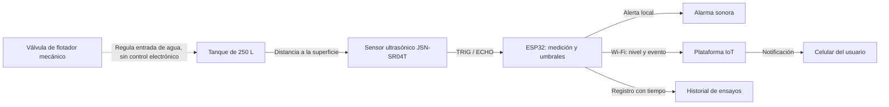

# Prototipo, montaje o arquitectura implementada

**Proyecto:** Desarrollo y validación de un método para detectar fallas en válvulas de flotador mecánico de tanques de almacenamiento de agua  
**Institución:** Universidad Tecnológica de Pereira (UTP) — Ingeniería Mecatrónica  
**Autores:** Ronaldo Ducuara Alape, Santiago Londoño Valencia y Yeison Eduardo Gonzalez  
**Director:** Osiel Arbeláez Salazar  
**Revisión:** P0.1 — arquitectura definida a nivel de diseño; montaje físico **pendiente de documentar**.

## 1. ¿Qué contiene esta carpeta?

Esta carpeta reúne la **arquitectura prevista**, el procedimiento de integración y los formatos para documentar el **montaje real** del prototipo de supervisión de nivel en el tanque de **250 L** del banco de pruebas de la UTP.

> **Estado actual:** los diagramas y documentos son propuestas de implementación, no evidencia de un sistema ya instalado o validado. No se han añadido fotografías, registros de puesta en marcha ni resultados medidos. Los incorporaríamos aquí una vez exista evidencia real.

## 2. Función del sistema

El sistema se plantea como respaldo de supervisión **independiente** de la válvula de flotador mecánico: mide el nivel del agua con un **JSN-SR04T**, procesa las mediciones mediante un **ESP32**, activa una **alarma sonora** ante niveles anormalmente altos o bajos y envía un aviso mediante **Wi-Fi y una plataforma IoT** al celular del usuario.

**No acciona la válvula, no controla el llenado, no identifica la pieza averiada y no sustituye la inspección del mecanismo.**



## 3. Estructura de la carpeta

```text
Prototipo_Montaje_Arquitectura/
├── README.md
├── 01_Arquitectura/
│   ├── A-01_Arquitectura.drawio
│   ├── A-01_Arquitectura.svg
│   ├── A-02_Flujo_funcional.mmd
│   └── A-03_Descripcion_funcional.md
├── 02_Montaje/
│   ├── M-01_Implantacion_banco.svg
│   ├── M-02_Esquema_electrico_preliminar.svg
│   ├── M-03_Guia_de_montaje.md
│   ├── M-04_Lista_de_verificacion.md
│   └── M-05_Interfaces_y_parametros.md
├── 03_Evidencias/
│   ├── README.md
│   ├── F-01_Registro_montaje_PLANTILLA.md
│   ├── F-02_Registro_puesta_en_marcha_PLANTILLA.md
│   └── Fotografias/
│       └── README.md
└── 04_Control_de_cambios/
    └── HISTORIAL.md
```

Los diagramas de esta carpeta derivan del paquete de **modelos, planos y archivos de diseño** R0, y se repiten aquí como apoyo directo al montaje. Los CAD, STEP, STL y DXF completos permanecen en aquella carpeta de diseños.

## 4. Arquitectura y montaje propuesto

| Subsistema | Elemento | Función | Estado |
|---|---|---|---|
| Proceso físico | Tanque de 250 L y válvula mecánica | Reproducir llenado, cierre y consumo | Banco descrito en el anteproyecto; montaje del sistema por registrar |
| Medición | JSN-SR04T | Registrar distancia a la superficie y convertirla en nivel | Seleccionado; revisión de sensor por confirmar |
| Control y registro | ESP32 | Aplicar umbrales, confirmación y registrar eventos | Seleccionado; firmware por integrar |
| Aviso local | Buzzer con etapa de accionamiento | Señalizar condición alta o baja | Diseño preliminar |
| Comunicaciones | Wi-Fi y plataforma IoT | Guardar nivel/eventos y notificar al celular | Plataforma y conectividad por configurar |
| Verificación | Referencia graduada fija | Comparar lecturas del sensor con el nivel real | Prevista en el banco |

El nivel se calculará mediante **`h = Hs − d`**, donde `Hs` es la altura instalada del sensor respecto al fondo del tanque y `d` es la distancia medida hasta la superficie libre. Se debe confirmar el montaje vertical y la distancia mínima de medición **en la ficha técnica de la versión adquirida**.

Los escenarios previstos para comprobar el comportamiento del sistema son: **N** (normal), **E1** (desgaste del sello), **E2a** (bloqueo con rebose), **E2b** (bloqueo sin apertura) y **E3** (pérdida de flotabilidad de la boya). El aviso indicará solamente **nivel alto o nivel bajo**, sin identificar automáticamente E1–E3.

## 5. Evidencias que deben incorporarse tras el montaje

1. **Fotografías fechadas** de vista general del banco, posición del sensor, electrónica protegida, alimentación y referencia graduada.
2. **Versión final del esquema de conexión** y listado de GPIO realmente utilizados.
3. **Registro de altura `Hs` y umbrales** definidos en la caracterización (OE1).
4. **Registro de puesta en marcha**: lectura estable, activación de alarma local y asociación evento–aviso IoT.
5. **Código o revisión del firmware**, plataforma IoT y configuración de muestreo empleada (sin publicar contraseñas).
6. **Observaciones o cambios respecto al diseño** y evidencias de corrección.

La validez del sistema se determinará con el protocolo de evaluación del anteproyecto (**OE4**) y no con fotografías por sí solas. Las metas previstas incluyen error de nivel **menor a 2 cm**, **al menos 95 % de aciertos**, y tiempos de detección y aviso inferiores a los máximos que se definan en OE1. Son **criterios de aceptación, no resultados obtenidos**.

## 6. Documentos relacionados

- [`01_Arquitectura/A-03_Descripcion_funcional.md`](01_Arquitectura/A-03_Descripcion_funcional.md): estados y flujo de señales.
- [`02_Montaje/M-03_Guia_de_montaje.md`](02_Montaje/M-03_Guia_de_montaje.md): pasos propuestos de instalación.
- [`02_Montaje/M-04_Lista_de_verificacion.md`](02_Montaje/M-04_Lista_de_verificacion.md): verificaciones antes y después de energizar.
- [`03_Evidencias/README.md`](03_Evidencias/README.md): guía para evidencias reales y formatos.
- [`04_Control_de_cambios/HISTORIAL.md`](04_Control_de_cambios/HISTORIAL.md): control de versiones.

## 7. Seguridad y límites

Mantener la electrónica fuera de zonas de salpicadura y en gabinete protegido; usar fuente certificada; adaptar **ECHO** al nivel lógico tolerado por el ESP32 antes de conectarlo; supervisar los ensayos de rebose y disponer de desagüe. No energizar montajes sin revisión del cableado y condiciones de seguridad. Solo se proyecta la validación experimental en el banco de 250 L; no se presenta como validación directa de tanques de 10 000 L.

**Fuentes del proyecto:** anteproyecto de grado, secciones 2.3, 4, 7, 8 y 9; *Manual técnico y de operación v0.1*, secciones 1–8; planos preliminares R0.  
**Nota de trazabilidad:** al cerrar la integración deben actualizarse el estado de cada componente, las evidencias y el código de revisión de esta carpeta.
